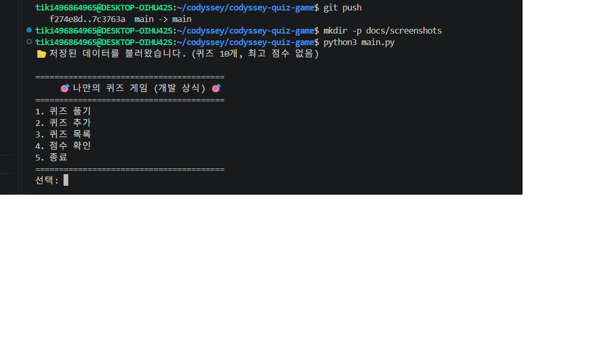
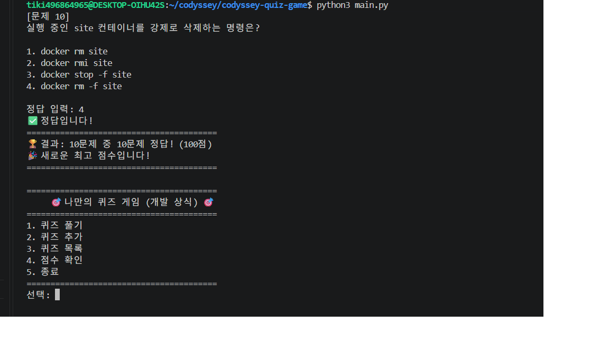
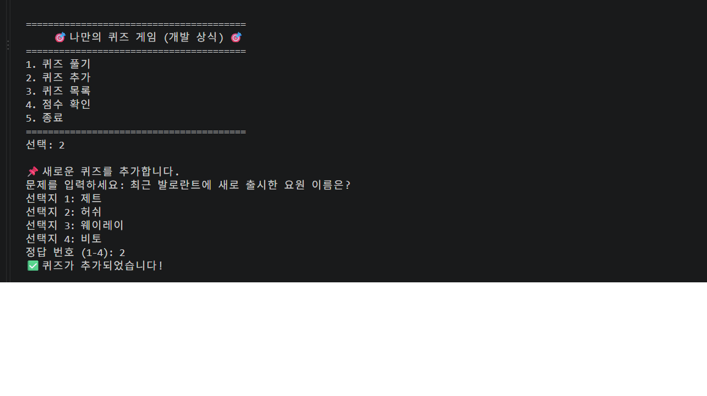
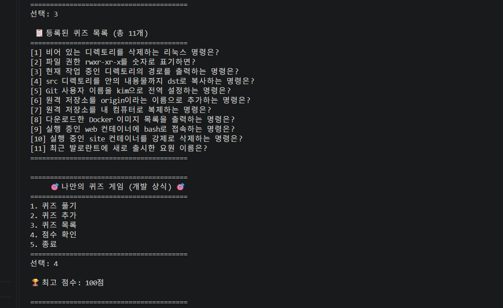
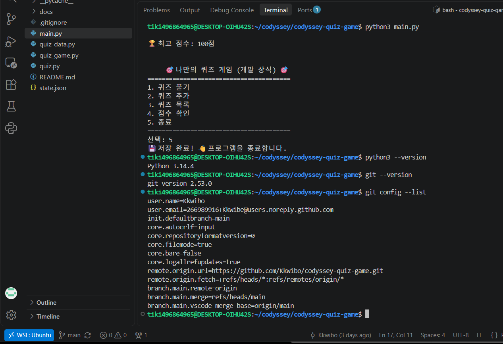
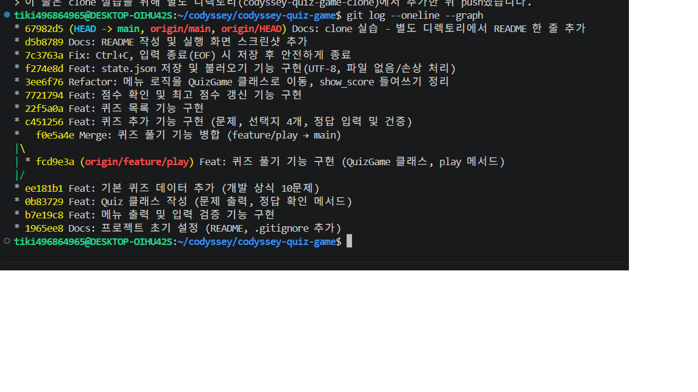

# 🎯 나만의 퀴즈 게임 - 개발 상식 퀴즈

터미널에서 동작하는 객관식 퀴즈 게임입니다.
Python 기본 문법과 클래스로 기능을 나누어 구현하고, 퀴즈와 최고 점수를 `state.json`에 저장해 프로그램을 다시 실행해도 데이터가 유지됩니다.
개발 과정은 Git으로 기능 단위 커밋, 브랜치 생성·병합, clone·pull까지 기록했습니다.

## 목차

1. [프로젝트 개요](#1-프로젝트-개요)
2. [퀴즈 주제와 선정 이유](#2-퀴즈-주제와-선정-이유)
3. [실행 방법](#3-실행-방법)
4. [기능 목록](#4-기능-목록)
5. [실행 화면](#5-실행-화면)
6. [파일 구조와 클래스 설계](#6-파일-구조와-클래스-설계)
7. [데이터 파일 설명 (state.json)](#7-데이터-파일-설명-statejson)
8. [개발 환경](#8-개발-환경)
9. [Git 작업 기록](#9-git-작업-기록)
10. [트러블슈팅](#10-트러블슈팅)

---

## 1. 프로젝트 개요

| 항목 | 내용 |
|---|---|
| 프로그램 | 터미널(콘솔) 기반 객관식 퀴즈 게임 |
| 언어 | Python 3.10 이상 (표준 라이브러리만 사용) |
| 주요 기능 | 퀴즈 풀기 / 퀴즈 추가 / 퀴즈 목록 / 최고 점수 확인 / 종료 |
| 데이터 저장 | 프로젝트 루트의 `state.json` (UTF-8) |
| 코드 구조 | `Quiz`(문제 1개), `QuizGame`(게임 전체) 2개 클래스로 역할 분리 |

---

## 2. 퀴즈 주제와 선정 이유

**주제: 개발 상식 (리눅스 · Git · Docker 명령어)**

1-1 과제와 CLI 단답형 연습에서 리눅스, Git, Docker 명령을 자주 헷갈렸고, 그때 틀렸던 명령을 오답 선택지로 넣어서 반복해서 복습하려고 이 주제를 선택했습니다.

| 분야 | 문제 수 | 예시 |
|---|---|---|
| 리눅스 | 4 | 빈 디렉토리 삭제, 권한 숫자 표기(755), 현재 경로 출력, 디렉토리 복사(`-r`) |
| Git | 3 | 사용자 이름 전역 설정, 원격 저장소 추가, 저장소 복제 |
| Docker | 3 | 이미지 목록, 컨테이너 접속(`exec -it`), 강제 삭제(`rm -f`) |

---

## 3. 실행 방법

### 요구 사항

- Python **3.10 이상**
- 외부 라이브러리 설치 필요 없음 (표준 라이브러리 `json`, `pathlib`만 사용)

### 실행

```bash
git clone https://github.com/Kkwibo/codyssey-quiz-game.git
cd codyssey-quiz-game
python3 main.py
```

> Windows(PowerShell)에서 Python을 직접 설치한 경우 `python main.py`로 실행합니다.

### 처음 실행할 때

`state.json`이 없으면 기본 퀴즈 10개로 시작하고, 퀴즈를 추가하거나 최고 점수가 갱신되거나 종료할 때 `state.json`이 자동으로 만들어집니다.

```
📂 저장된 데이터가 없어 기본 퀴즈로 시작합니다.
```

---

## 4. 기능 목록

### 메뉴 기능

| 메뉴 | 기능 | 설명 |
|---|---|---|
| 1 | 퀴즈 풀기 | 저장된 퀴즈를 순서대로 출제하고, 문제마다 정답/오답을 알려 줍니다. 마지막에 정답 수와 점수(100점 만점)를 보여 주고, 최고 점수보다 높으면 갱신합니다. 퀴즈가 없으면 안내 후 메뉴로 돌아갑니다. |
| 2 | 퀴즈 추가 | 문제, 선택지 4개, 정답 번호(1~4)를 입력받아 새 퀴즈를 등록하고 즉시 파일에 저장합니다. |
| 3 | 퀴즈 목록 | 등록된 퀴즈의 번호와 문제를 출력합니다. 퀴즈가 없으면 안내 메시지를 출력합니다. |
| 4 | 점수 확인 | 최고 점수를 출력합니다. 아직 퀴즈를 풀지 않았다면 안내 메시지를 출력합니다. |
| 5 | 종료 | 데이터를 저장하고 프로그램을 종료합니다. |

### 입력 / 예외 처리

| 상황 | 예시 입력 | 처리 |
|---|---|---|
| 앞뒤 공백 | ` 1 ` | 공백을 제거한 뒤 정상 처리 |
| 숫자가 아닌 입력 | `abc` | ⚠️ 안내 후 다시 입력 |
| 허용 범위 밖 숫자 | 메뉴 `9`, 정답 `0` | ⚠️ 안내 후 다시 입력 |
| 빈 입력 | Enter | ⚠️ 안내 후 다시 입력 |
| 빈 문제·선택지 (퀴즈 추가) | Enter, 공백만 | ⚠️ 안내 후 다시 입력 |
| Ctrl + C (`KeyboardInterrupt`) | | 안내 메시지 → 저장 → 안전 종료 |
| 입력 종료 (`EOFError`, Ctrl + D) | | 안내 메시지 → 저장 → 안전 종료 |
| `state.json` 없음 | | 기본 퀴즈 데이터로 시작 |
| `state.json` 손상 | | ⚠️ 안내 후 기본 퀴즈 데이터로 복구 |

---

## 5. 실행 화면

### 메뉴



### 퀴즈 풀기



### 퀴즈 추가



### 퀴즈 목록 · 점수 확인



---

## 6. 파일 구조와 클래스 설계

### 파일 구조

```
codyssey-quiz-game/
├── main.py              # 프로그램 시작점 (QuizGame 실행, Ctrl+C·EOF 처리)
├── quiz.py              # Quiz 클래스: 퀴즈 1문제
├── quiz_game.py         # QuizGame 클래스: 메뉴·풀기·추가·목록·점수·저장/불러오기
├── quiz_data.py         # 기본 퀴즈 10문제 (state.json이 없을 때 사용)
├── state.json           # 실행 중 생성되는 데이터 파일 (Git 제외)
├── .gitignore           # __pycache__, state.json 등 제외 목록
├── README.md
└── docs/
    └── screenshots/     # 실행 화면, 개발 환경, git log 스크린샷
```

### 클래스 설계

**`Quiz`** (`quiz.py`) - 퀴즈 한 문제를 표현합니다.

| 구분 | 이름 | 설명 |
|---|---|---|
| 속성 | `question` (str) | 문제 |
| 속성 | `choices` (list) | 선택지 4개 |
| 속성 | `answer` (int) | 정답 번호 (1~4) |
| 메서드 | `display(number)` | 문제 번호와 함께 문제·선택지 출력 |
| 메서드 | `is_correct(user_answer)` | 정답 여부를 `True`/`False`로 반환 |
| 메서드 | `to_dict()` | JSON 저장용 dict로 변환 |
| 메서드 | `from_dict(data)` (classmethod) | dict에서 Quiz 객체 생성, 형식이 잘못되면 `ValueError` |

**`QuizGame`** (`quiz_game.py`) - 게임 전체를 관리합니다.

| 구분 | 이름 | 설명 |
|---|---|---|
| 속성 | `quizzes` (list) | Quiz 객체 목록 |
| 속성 | `best_score` (int 또는 None) | 최고 점수. 아직 풀지 않았으면 `None` |
| 메서드 | `run()` | 종료를 고를 때까지 메뉴 반복 |
| 메서드 | `show_menu()` | 메뉴 출력 |
| 메서드 | `play()` | 퀴즈 풀기, 점수 계산, 최고 점수 갱신 |
| 메서드 | `add_quiz()` | 퀴즈 추가 |
| 메서드 | `show_quizzes()` | 퀴즈 목록 출력 |
| 메서드 | `show_score()` | 최고 점수 출력 |
| 메서드 | `load()` / `save()` | `state.json` 불러오기 / 저장 |

입력 검증은 모듈 함수 `get_number(prompt, min, max)`와 `get_text(prompt)`로 분리해, 메뉴 선택(1~5)·정답 입력(1~4)·퀴즈 추가에서 재사용합니다.

---

## 7. 데이터 파일 설명 (state.json)

| 항목 | 내용 |
|---|---|
| 경로 | 프로젝트 루트의 `state.json` (`quiz_game.py`와 같은 폴더) |
| 인코딩 | UTF-8 (`ensure_ascii=False`로 한글을 그대로 저장) |
| 역할 | 퀴즈 목록과 최고 점수를 저장해, 프로그램을 다시 실행해도 데이터 유지 |
| 저장 시점 | 퀴즈 추가 직후, 최고 점수 갱신 직후, 종료(메뉴 5 / Ctrl+C / EOF) 시 |
| 불러오는 시점 | 프로그램 시작 시 (`QuizGame` 생성 시 `load()`) |
| Git 관리 | 실행할 때마다 내용이 바뀌는 파일이라 `.gitignore`로 제외 |

### 필드 구조

| 키 | 타입 | 설명 |
|---|---|---|
| `quizzes` | list | 퀴즈 목록 |
| `quizzes[].question` | str | 문제 |
| `quizzes[].choices` | list (str 4개) | 선택지 |
| `quizzes[].answer` | int (1~4) | 정답 번호 |
| `best_score` | int (0~100) 또는 `null` | 최고 점수 (정답 수 ÷ 문제 수 × 100, 반올림). 아직 풀지 않았으면 `null` |

### 예시

```json
{
  "quizzes": [
    {
      "question": "비어 있는 디렉토리를 삭제하는 리눅스 명령은?",
      "choices": ["rmdir", "rm", "redir", "mkdir"],
      "answer": 1
    }
  ],
  "best_score": 91
}
```

### 파일이 없거나 손상된 경우

| 상황 | 동작 |
|---|---|
| 파일 없음 (첫 실행) | `📂 저장된 데이터가 없어 기본 퀴즈로 시작합니다.` → 기본 퀴즈 10개 |
| JSON 형식 오류, 키 누락, 선택지 개수·정답 범위 오류 | `⚠️ 저장 파일이 손상되어 기본 퀴즈로 복구합니다.` → 기본 퀴즈 10개, 종료 시 올바른 형식으로 다시 저장 |
| 파일을 읽을 수 없음 (권한 등) | `⚠️ 저장 파일을 읽을 수 없어 기본 퀴즈로 시작합니다.` |

---

## 8. 개발 환경

| 항목 | 내용 |
|---|---|
| OS | Windows + WSL2 (Ubuntu) |
| Python | 3.14.4 |
| Git | 2.53.0 |
| 에디터 | Visual Studio Code + WSL 확장 + Python 확장 |



---

## 9. Git 작업 기록

### 커밋 규칙

기능 단위로 커밋하고, 메시지 앞에 작업 종류를 붙였습니다.

| 접두어 | 의미 | 예시 |
|---|---|---|
| `Feat` | 새 기능 | `Feat: 퀴즈 목록 기능 구현` |
| `Fix` | 문제 수정 | `Fix: Ctrl+C, 입력 종료(EOF) 시 저장 후 안전하게 종료` |
| `Refactor` | 동작은 그대로, 구조 개선 | `Refactor: 메뉴 로직을 QuizGame 클래스로 이동` |
| `Docs` | 문서 | `Docs: README 작성` |

### 브랜치 작업

퀴즈 풀기 기능은 `feature/play` 브랜치에서 개발한 뒤 `main`에 병합했습니다.
`--no-ff` 옵션으로 병합 커밋을 남겨 그래프에서 브랜치 기록이 보이도록 했습니다.

```bash
git checkout -b feature/play      # 브랜치 생성 및 이동
# ... 퀴즈 풀기 기능 개발 ...
git commit -m "Feat: 퀴즈 풀기 기능 구현 (QuizGame 클래스, play 메서드)"
git push -u origin feature/play
git checkout main                 # main으로 이동
git merge --no-ff feature/play    # 병합
git push
```

### clone · pull

- **clone**: 학교 PC에서 작업한 저장소를 노트북에서 `git clone`으로 받아 이어서 개발했습니다.
- **복제 실습**: 저장소를 별도 디렉토리에 `clone` → README 수정 → `commit`, `push` → 원래 작업 디렉토리에서 `git pull`로 변경 사항을 가져왔습니다.

### Git 기초 명령 사용

| 명령 | 사용한 곳 |
|---|---|
| `init` | 로컬 저장소 생성 |
| `add` / `commit` | 기능 단위 커밋 |
| `push` | GitHub 업로드 |
| `checkout` | `feature/play` 브랜치 생성·이동, `main` 복귀 |
| `clone` | 노트북에서 저장소 받기, 복제 실습 |
| `pull` | 복제 실습 후 원래 디렉토리에서 변경 사항 가져오기 |

### 커밋 그래프

```bash
git log --oneline --graph
```



---

## 10. 트러블슈팅

| 문제 | 원인 | 해결 |
|---|---|---|
| `wsl ~` 실행 시 `docker-desktop`으로 들어가고 `python3`, `git`이 없음 | Ubuntu가 설치되지 않아 Docker Desktop의 내부 배포판이 기본으로 지정됨 | `wsl --install -d Ubuntu`로 설치 후 `wsl.exe --set-default Ubuntu` |
| `git push` 시 터미널에서 Username을 물음 | Git이 GitHub 인증 정보를 가져올 곳이 없음 | VSCode에서 GitHub 로그인 후 VSCode(WSL) 터미널에서 push |
| 점수 확인 시 `AttributeError: 'QuizGame' object has no attribute 'show_score'` | `show_score`를 8칸 들여써서 `show_quizzes` 안의 내부 함수가 됨 | 4칸으로 맞춰 `QuizGame`의 메서드로 수정 |
| `git config --list`의 이메일이 `user.noreplay...`로 저장됨 | 이메일 주소 오타 | 올바른 noreply 주소로 `git config --global user.email` 재설정 |
| Ctrl + C를 누르면 `KeyboardInterrupt` 에러로 비정상 종료 | 예외 처리가 없었음 | `main.py`에서 `KeyboardInterrupt`, `EOFError`를 잡아 저장 후 종료 |
> 이 줄은 clone 실습을 위해 별도 디렉토리(codyssey-quiz-game-clone)에서 추가한 뒤 push했습니다.
